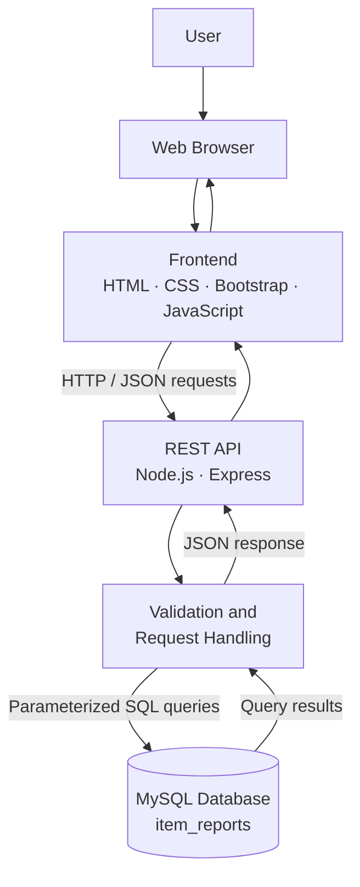

# Campus Lost & Found Management System

A web-based platform that helps campus communities report lost and found belongings, browse existing reports, and search for items through a centralized interface.

## Overview

The **Campus Lost & Found Management System** provides a simple and organized way to manage lost and found item reports within a campus environment.

Instead of relying entirely on notice boards or scattered messages, users can submit item details through a reporting form and browse existing reports to find relevant information. The application validates submitted data on both the client and server sides and stores valid reports in a MySQL database.

The project follows a client–server architecture, with a lightweight frontend communicating with a REST API built using Node.js and Express.

## Features

### Item Reporting
- Submit reports for lost and found items.
- Capture item name, category, date, location, description, and contact details.
- Validate required fields before submission.
- Validate email and phone formats.
- Reject invalid dates, including future dates.
- Store valid reports in the MySQL database.
- Return a confirmation response after successful submission.

### Browse and Search
- Browse previously submitted item reports.
- Search reports using keywords.
- Filter reports by item type and category.
- Combine supported search and filter criteria.
- Display an appropriate message when no matching reports are found.
- Clear filters to restore the full list.

### Backend Validation and Error Handling
- Validate incoming API data on the server.
- Reject unsupported filter values.
- Handle malformed JSON requests with structured JSON error responses.
- Limit request body size and handle oversized payloads.
- Use parameterized SQL queries for database operations.

### Database Persistence
- Store item reports in MySQL.
- Retrieve stored reports through the backend API.
- Verify submitted records directly in the database during testing.

## Technology Stack

| Layer | Technologies |
|---|---|
| Frontend | HTML5, CSS3, JavaScript |
| UI Framework | Bootstrap |
| Backend Runtime | Node.js |
| Backend Framework | Express.js |
| Database | MySQL |
| API Communication | HTTP and JSON |
| Development Tools | Visual Studio Code, npm |
| Testing | Browser testing, cURL, PowerShell, MySQL queries |
| Version Control | Git and GitHub |
| Project Management | Jira |

## System Architecture

The application uses a three-tier client–server architecture.



### Request Flow

1. A user interacts with the reporting or browsing interface in the browser.
2. The frontend sends an HTTP request to the Express backend.
3. The backend validates the incoming data or query parameters.
4. Valid requests are processed using the database layer.
5. MySQL stores new reports or returns matching records.
6. The backend sends an appropriate JSON response to the frontend.
7. The frontend displays the result, confirmation, validation message, or error state.

### Architectural Responsibilities

- **Presentation layer:** Displays pages, forms, item listings, search controls, and validation feedback.
- **Application layer:** Handles API routes, validation, request processing, and error responses.
- **Data layer:** Persists item reports in MySQL and supports retrieval and filtering.

## Project Structure

```text
campus-lost-found/
│
├── Backend/
│   ├── config/
│   │   └── db.js
│   │
│   ├── controllers/
│   │   └── reportController.js
│   │
│   ├── db/
│   │   └── schema.sql
│   │
│   ├── routes/
│   │   └── reportRoutes.js
│   │
│   ├── validators/
│   │   └── reportValidator.js
│   │
│   ├── server.js
│   ├── package.json
│   └── .env
│
├── public/
│   ├── index.html
│   ├── browse.html
│   ├── report.html
│   ├── styles.css
│   └── js/
│       ├── report.js
│       └── browse.js
│
├── .gitignore
└── README.md
```

*The tree shows the known main files; retain any additional files and directories that exist in the actual repository.*

## Database Design

The application uses MySQL for persistent storage. The primary report table is named `item_reports`.

The known report fields include:

| Field | Purpose |
|---|---|
| `report_type` | Identifies a report as LOST or FOUND |
| `item_name` | Name of the item |
| `category` | Item category |
| `item_date` | Date the item was lost or found |
| `location` | Relevant campus location |
| `description` | Additional item information |
| `contact_name` | Contact person's name |
| `contact_email` | Email contact information |
| `contact_phone` | Phone contact information |

The database schema is maintained in `Backend/db/schema.sql`.

### Data Integrity

- Required values are validated before insertion.
- Contact information is checked for valid formatting.
- Invalid requests are rejected before normal report creation.
- Parameterized SQL queries help prevent SQL injection through user-provided values.
- Database records can be verified using MySQL queries.

## REST API

The backend exposes report-related REST endpoints under `/api/reports`.

| Method | Endpoint | Purpose |
|---|---|---|
| `POST` | `/api/reports` | Submit a new lost or found report |
| `GET` | `/api/reports` | Retrieve reports and apply supported search or filter criteria |

### Submit a Report

`POST /api/reports`

The request body is JSON and contains the supported report fields, including report type, item details, date, location, and contact information.

Example request:

```json
{
  "report_type": "LOST",
  "item_name": "Blue Wallet",
  "category": "Accessories",
  "item_date": "2026-10-19",
  "location": "Library",
  "description": "A blue wallet with a card holder",
  "contact_name": "Example User",
  "contact_email": "user@example.com",
  "contact_phone": ""
}
```

A successful submission returns an HTTP `201 Created` response with a confirmation message and the generated report ID.

Invalid report data is rejected with an appropriate client error response.

### Retrieve and Filter Reports

`GET /api/reports`

The endpoint returns report data in JSON format. Supported query parameters can be used to search by keyword and filter by report type or category.

Example:

```http
GET /api/reports?type=FOUND&category=Electronics
```

The backend validates supported filter values and returns matching reports. Invalid filter values produce an HTTP `400 Bad Request` response.

### Error Handling

The backend handles common request errors, including:

| Scenario | HTTP status |
|---|---:|
| Invalid report data | `400 Bad Request` |
| Malformed JSON request body | `400 Bad Request` |
| Unsupported filter value | `400 Bad Request` |
| Request body exceeds the configured limit | `413 Payload Too Large` |
| Successful report creation | `201 Created` |

Error responses use JSON for the documented cases, allowing the frontend or API client to handle errors consistently.

## Getting Started

### Prerequisites

Install the following before running the application:

- [Node.js](https://nodejs.org/)
- npm, included with Node.js
- [MySQL Server](https://dev.mysql.com/downloads/mysql/)
- [Git](https://git-scm.com/)
- A code editor such as [Visual Studio Code](https://code.visualstudio.com/)

### 1. Clone the Repository

```bash
git clone <YOUR_REPOSITORY_URL>
cd <YOUR_REPOSITORY_DIRECTORY>
```

Replace the placeholders with the actual repository URL and directory name.

### 2. Configure MySQL

Start your MySQL server and create the application database if it does not already exist.

```sql
CREATE DATABASE IF NOT EXISTS campus_lost_found;
```

Execute the SQL statements in `Backend/db/schema.sql` using MySQL Workbench or the MySQL command-line client.

Ensure the database name and connection settings match your local configuration.

### 3. Configure Environment Variables

Create a `.env` file inside the `Backend` directory. Use the variable names expected by `Backend/config/db.js`.

For a configuration using these conventional names, the values would look like:

```env
DB_HOST=localhost
DB_USER=your_mysql_username
DB_PASSWORD=your_mysql_password
DB_NAME=campus_lost_found
DB_PORT=3306
```

Replace the example credentials with your own. Confirm the actual variable names in your database configuration before starting the server.

**Security:** Never commit `.env` files or real database credentials to a public repository.

### 4. Install Backend Dependencies

```bash
cd Backend
npm install
```

### 5. Start the Backend

```bash
npm run dev
```

The development script uses the project's configured command. If it starts the server on port `3000`, the local application API will be available at:

```text
http://localhost:3000/api/reports
```

Check the server startup output for the actual port and any database connection errors.

### 6. Open the Application

Open the application through the configured local server in your browser. If the server serves the frontend, visit its local root URL, for example:

```text
http://localhost:3000
```

Use the reporting interface to create reports and the browsing interface to search or filter existing records.

> If the frontend is configured to be opened separately rather than served by Express, follow the paths and instructions in the actual project configuration.

## Testing

Testing covers the main reporting and browsing workflows, input validation, database persistence, and API error handling.

### Functional Testing

- Submit valid LOST and FOUND reports.
- Check required-field validation.
- Test invalid email and phone formats.
- Verify that future dates are rejected.
- Confirm that valid reports are stored in MySQL.
- Browse existing reports.
- Search using keywords.
- Apply report-type and category filters.
- Check the no-results state.
- Clear filters and restore the full listing.
- Submit invalid filter values and confirm they are rejected.

### Robustness Testing

- Send malformed JSON to the report endpoint.
- Send a request body exceeding the configured size limit.
- Confirm that errors return the expected HTTP status and JSON message.
- Retest validation after correcting defects.

The malformed-JSON response handling and email-format validation were improved during development. Testing also confirmed that oversized request bodies are rejected with HTTP `413`.

## Error Handling and Validation

Validation is implemented at multiple levels:

- **Client-side validation** provides immediate feedback while users fill out the form.
- **Server-side validation** independently checks submitted data before database operations.
- **Centralized error handling** formats supported request parsing errors.
- **Request-size limits** protect the server from excessively large JSON payloads.
- **Parameterized queries** separate SQL statements from user-provided values.

Client-side validation improves usability, but server-side validation remains necessary because API requests can be sent without using the browser interface.

## Development Workflow

Git and GitHub are used for source control, while Jira is used to organize development work and track issues.

The workflow includes:

1. Breaking functionality into manageable work items.
2. Implementing features in the frontend and backend.
3. Testing the API, user interface, and database interactions.
4. Recording defects and their reproduction steps.
5. Fixing issues and verifying the changes.
6. Maintaining project documentation.

## Future Improvements

Potential extensions to the system include:

- User registration and authentication.
- Item image uploads.
- Ownership verification and claim management.
- Notifications when relevant items are reported.
- More advanced search and filtering options.
- Pagination for larger report collections.
- Automated API tests and continuous integration.
- Deployment to a production hosting environment.

These are possible future enhancements and are not represented as existing functionality.

## Contributing

Contributions and suggestions are welcome.

1. Fork the repository.
2. Create a feature branch.
3. Implement and test your changes.
4. Submit a pull request describing the changes.

Please avoid committing credentials, local environment files, or generated dependencies.

## License

No license has been specified here. Add a `LICENSE` file and name the license in this section if you intend to distribute the project under an open-source license.

---

**Campus Lost & Found Management System** is a web application built with HTML, CSS, Bootstrap, JavaScript, Node.js, Express, and MySQL to organize lost and found item reporting, browsing, and search through a centralized platform.